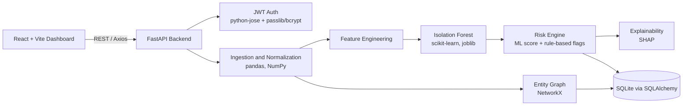

# ChainShield AI

**Explainable AI platform for Bitcoin transaction forensics and illicit-activity detection.**

Built for **Smart India Hackathon (SIH) 2026**. Selected at the college-level round at **Teerthanker Mahaveer University (TMU), Moradabad**.


**Live demo:** _add Vercel link_
**API docs:** _add Render link_/docs

> The backend runs on a free tier. The first request after idle can take about 50 seconds.

**Keywords:** Bitcoin, blockchain analytics, transaction tracing, anti-money laundering (AML), anomaly detection, Isolation Forest, SHAP, explainable AI (XAI), graph analytics, entity resolution, FastAPI, React, machine learning, fraud detection

---

## Problem

Bitcoin is pseudonymous, and illicit actors exploit this for money laundering, mixing and layering, peel chains, fund fragmentation and scam payouts. Investigators trace funds across thousands of transactions and wallets by hand, and most black-box detectors cannot explain why a transaction was flagged, which makes the output hard to defend in an investigation.

## Solution

ChainShield AI is a single investigator dashboard that:

1. Ingests transaction datasets (CSV / JSON / XML) and normalizes them to one schema
2. Engineers behavioural features per transaction and per wallet
3. Detects outliers with unsupervised ML (Isolation Forest)
4. Produces a risk score by combining the ML score with rule-based red flags
5. Explains every score with SHAP feature attributions
6. Traces fund flow across wallets using an entity graph (NetworkX)

---

## Architecture



### Analysis pipeline

```text
Raw dataset -> Normalize -> Feature engineering -> Isolation Forest
            -> Rule-based flags -> Risk score -> SHAP explanation
            -> Entity graph + tracing -> Investigation record
```

---

## Features

| Area | What it does |
|---|---|
| Multi-format ingestion | CSV / JSON / XML import with schema normalization |
| Anomaly detection | Unsupervised Isolation Forest finds rare, suspicious transactions without labels |
| Risk scoring | ML anomaly score combined with rule-based red-flag heuristics |
| Explainable AI | SHAP feature contributions for each flagged transaction |
| Graph analytics | NetworkX entity graph, wallet relationships, in/out flow, path tracing |
| Investigations | Save and revisit analysis results |
| Security | JWT authentication, bcrypt password hashing, env-driven CORS, no hardcoded secrets |
| Dashboard | React + Recharts visualizations, transaction search, entity graph view |

> Pages labelled **"demo data"** in the UI use static sample data for illustration.

---

## ML and Algorithms

| Technique | Purpose |
|---|---|
| Isolation Forest | Unsupervised anomaly detection on engineered transaction features |
| SHAP (SHapley Additive exPlanations) | Per-prediction attribution, so every alert has a reason |
| Rule-based heuristics | Amount, frequency and behaviour red flags layered on the model |
| Graph analysis (NetworkX) | Connected entities, flow analysis, path tracing between wallets |
| Feature engineering (pandas / NumPy) | Transaction and wallet-level behavioural features |
| Model persistence (joblib) | Trained models saved and loaded at startup |

---

## Tech Stack

| Layer | Technologies |
|---|---|
| Backend | Python 3.13, FastAPI, Uvicorn, Pydantic, SQLAlchemy, SQLite |
| AI / ML | scikit-learn, SHAP, pandas, NumPy, joblib |
| Graph | NetworkX |
| Security | JWT (python-jose), passlib + bcrypt, CORS allow-list via env |
| Frontend | React, Vite, Tailwind CSS, Axios, Recharts |
| Deployment | Render (API), Vercel (frontend) |

---

## Project Structure

```text
chainshield-ai/
  backend/
    app/            FastAPI app, auth, ML, graph and risk engines
    scripts/        Training and utility scripts
    data/sample/    Small demo datasets
    requirements.txt
    .env.example
  frontend/
    src/            React dashboard
    vercel.json     SPA rewrite for React Router
  LICENSE
  README.md
```

---

## Local Setup

### Backend

```bash
cd backend
python -m venv .venv
.venv\Scripts\activate
pip install -r requirements.txt
cp .env.example .env
uvicorn app.main:app --reload --port 8000
```

Set a strong `SECRET_KEY` in `.env`. The app refuses to start without it.

```bash
python -c "import secrets; print(secrets.token_hex(32))"
```

Interactive API docs: http://127.0.0.1:8000/docs

### Frontend

```bash
cd frontend
npm install
npm run dev
```

Runs on http://localhost:5173 and proxies `/api` to the backend on port 8000.

---

## Configuration

| Variable | Where | Purpose |
|---|---|---|
| `SECRET_KEY` | backend | JWT signing key (required, no default) |
| `ALGORITHM` | backend | JWT algorithm |
| `TOKEN_EXPIRE_MINUTES` | backend | Token lifetime |
| `CORS_ORIGINS` | backend | Comma-separated allowed frontend origins |
| `VITE_API_URL` | frontend | Backend base URL in production |

---

## Deployment

1. **Backend (Render):** Root Directory `backend`, build `pip install -r requirements.txt`, start `uvicorn app.main:app --host 0.0.0.0 --port $PORT`. Set `SECRET_KEY`, `ALGORITHM`, `TOKEN_EXPIRE_MINUTES`, `CORS_ORIGINS`, `PYTHON_VERSION`.
2. **Frontend (Vercel):** Root Directory `frontend`, framework Vite, env `VITE_API_URL=https://<service>.onrender.com`.
3. **CORS:** add the Vercel URL to `CORS_ORIGINS` on Render and redeploy.

---

## Data

- Demo datasets: `backend/data/sample/` (small, partly synthetic)
- Reference dataset: **Elliptic Bitcoin Dataset** (Kaggle). It is **not included** because of size and licence. Download it and place it in `backend/data/`.

---

## Limitations

- Free-tier backend sleeps after 15 minutes idle (first request about 50 s)
- SQLite is ephemeral on Render, so the database resets on restart
- Demo datasets are small and partly synthetic, so results are illustrative, not production-grade
- Isolation Forest is unsupervised, so precision depends on the data and needs analyst review

## Roadmap

- Mempool monitoring: unconfirmed transaction analysis (fee, size, RBF patterns)
- Live blockchain data feeds (full node / public APIs)
- Gradient boosting (XGBoost) and graph neural networks on Elliptic labelled data
- Pattern detectors: peel chains, mixers / CoinJoin, layering
- PostgreSQL for persistent storage
- Exportable investigation reports (PDF)
- Automated tests and CI (GitHub Actions)

---

## License

MIT, Copyright (c) 2026 Jamshed Alam